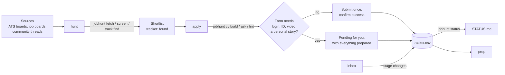

# How it works

## The split

An AI agent is good at reading messy postings, writing in your voice and operating a browser. It is bad at remembering what it did last week, counting pages, doing salary arithmetic consistently, and noticing it already applied somewhere.

So the repo splits the work:

| Layer | What | Where |
|---|---|---|
| Judgment | Searching, reading postings, tailoring text, filling forms, triaging email | The agent, guided by `AGENTS.md` + `workflows/` |
| Determinism | Duplicate checks, keyword screening, salary math, text linting, PDF rendering, page limits, status | The `jobhunt` CLI (`src/jobhunt/`) |
| State | Your facts, rules, tracker, generated files | `me/` (private, plain text) |

The agent calls the CLI the way a careful person uses a checklist. Every rule that can be checked by code is checked by code.

## Flow

## Design choices

- **Plain files, no database.** TOML for things you edit, CSV for the tracker (opens in any spreadsheet), Markdown for logs. Easy to read, diff, back up and hand to any model.
- **CV as data.** `cv.toml` holds each fact once. Tailoring picks, orders and rewords; it never adds. That is what keeps a hundred tailored CVs consistent and honest.
- **One page, enforced.** `jobhunt cv build` fails when a CV goes over `max_pages`.
- **Model-agnostic.** Instructions live in `AGENTS.md`, the format read natively by most coding agents. `CLAUDE.md` imports it and adds Claude-specific tips. Workflows are plain Markdown any model can follow.
- **No dependencies.** The CLI is standard-library Python, so `bin/jobhunt` works on a fresh machine and the supply-chain surface is zero.
- **Human gates by default.** The agent prepares; you approve anything that sends, submits under uncertainty, or can't be undone.

## Exit codes

Workflows rely on them, so they're stable: `0` ok, `1` error, `2` bad usage, `3` needs review, `4` blocked (rejected posting, lint failure, duplicate, over page limit).
